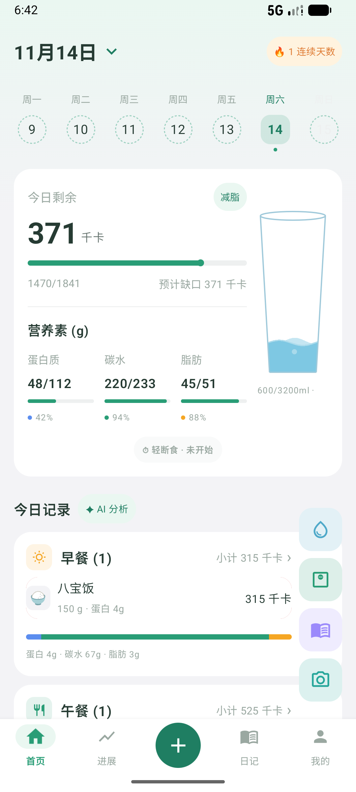
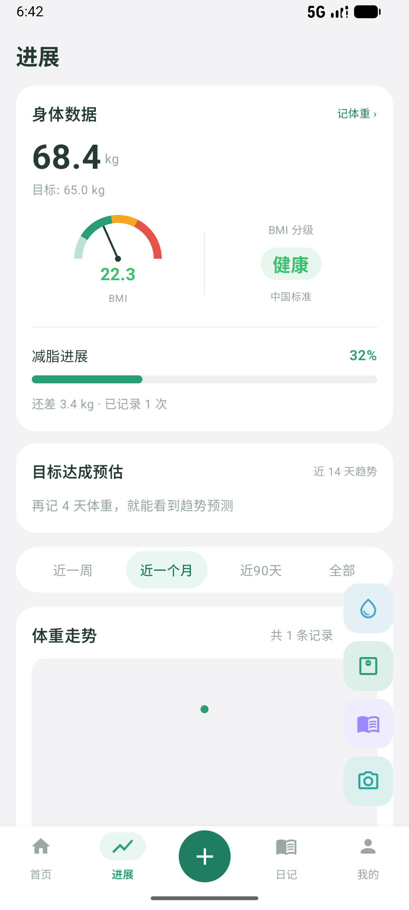
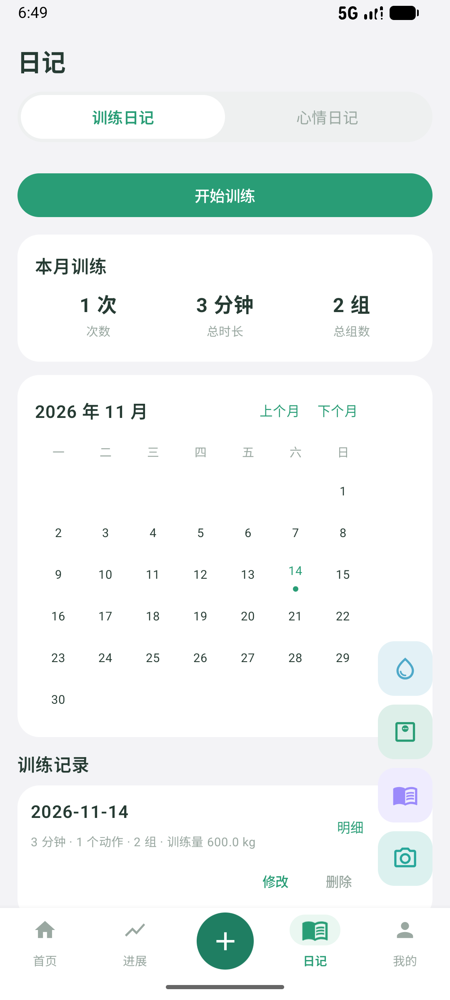
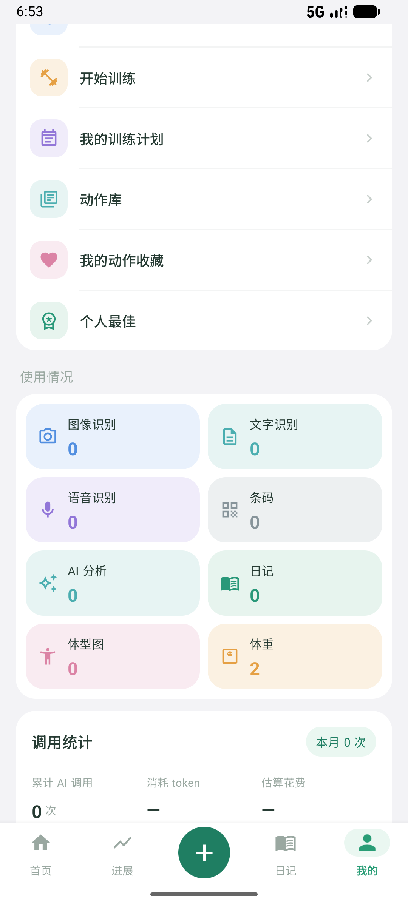
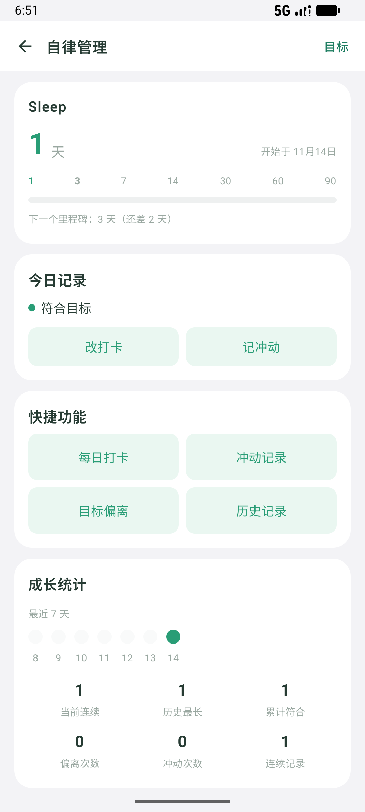

# 轻记 QingJi

**记下吃了什么、动了多少。数据留在手机里，不上传。**

饮食 · 体重 · 饮水 · 运动 · 断食 · 训练 · 日记 · 自律 · 无账号 · 无服务器 · AI 自己配 Key · 免费

[下载 v1.1.1](https://github.com/yueyinmin/QingJi-Android/releases/latest) · [能记什么](#能记什么) · [不做什么](#轻记不做什么) · [界面](#界面) · [快速开始](#快速开始) · [技术实现](#技术实现) · [反馈](#反馈)

## 轻记是什么

Android 上的个人记录应用，管八件事：饮食、体重、饮水、运动、断食、训练、日记、自律。数据存在手机本地的一个 SQLite 文件里，不注册账号，没有云同步，也没有轻记自己的服务器。卸载前在「设置 → 数据备份与导出」导出一份 JSON，换机后导回去。

需要 AI 帮忙认食物时，在设置里填你自己的服务商 Key。拍的照片直接发给你选的那家，轻记不中转、不代付、不留副本。不想用 AI 也行，食物库和手动录入覆盖同样的记录流程。

APK 3.3 MB，支持 Android 8.0 及以上。

## 能记什么

| 模块 | 记什么 | 怎么记 |
|---|---|---|
| **饮食** | 每餐食物、克数、热量、蛋白/碳水/脂肪 | 拍照 · 语音 · 文字描述 · 扫条码 · 食物库（654 条）· 手动填 |
| **体重** | 体重、体脂率、备注 | 手动输入，一天一条，再记会覆盖当天 |
| **饮水** | 每次喝了多少毫升 | 悬浮按钮一次一杯，或输自定义数值 |
| **运动** | 时长、千卡、步数、公里 | 按 MET 换算消耗，四种记法任选 |
| **断食** | 方案断食与自由断食 | 16:8 / 18:6 / 20:4 等方案，或自定义开始时间 |
| **训练** | 动作、组数、重量、次数、RPE | 从 38 个内置动作里选，自动带出上次成绩 |
| **日记** | 心情评分与文字、训练日记 | 手写，按月归档 |
| **自律** | 目标、每日打卡、冲动记录、目标偏离 | 自己设目标，按天数计时 |

饮食有两条硬规矩：AI 认出来的结果一定先过确认页，每一条都能改名、改克数、删掉；你改过的名字会被记住，下次自动纠回来。

### 看数据的地方

- **首页**：今日剩余热量、三大营养素进度、四餐明细、今日训练、今日自律、本周运动消耗与小结
- **进展**：体重曲线、BMI 仪表盘、按近 14 天趋势估算达标周数、围度、近一周饮水与营养
- **日记**：训练月历、本月总结、历史明细；心情日记按月排版
- **我的**：我的目标、成就（11 个）、自律管理、训练管理、使用情况统计

## 轻记不做什么

| 不做 | 说明 |
|---|---|
| **没有账号、没有云同步** | 数据只在本机。换手机靠导出 JSON，多设备之间不互通 |
| **不做订阅、不卖会员** | 全部功能免费。用 AI 产生的费用你直接付给服务商 |
| **不做医疗或营养诊断** | 热量、BMI、训练量都是估算值，不是医学结论 |
| **不给训练处方** | 内置动作只有名称、肌群、一句要点，不给重量和组数建议 |
| **不凑食物库数量** | 只有 654 条，每条标了来源和「未审核」，宁可少不编 |
| **只做 Android** | 没有 iOS、Web 和桌面版 |

## 界面

首页 · 今日剩余与四餐明细

进展 · BMI、减脂进度与体重走势

日记 · 训练月历与本月总结

我的 · 训练入口与使用情况

自律 · 计时、打卡入口与成长统计

截图数据为演示数据，不是真实用户记录。

## 快速开始

**1. 装包。** 从 [Releases](https://github.com/yueyinmin/QingJi-Android/releases/latest) 下最新 APK，覆盖安装即可升级。之前装过 debug 包的话先卸载——签名不同，系统会拒绝覆盖。

**2. 走 5 步引导。** 选目标（减脂 / 增肌 / 保持）、填性别年龄身高体重、选活动量。热量和营养目标当场算出来，之后能在「我的 → 我的目标」改。

**3. 想用 AI 识别，先配 Key。** 「设置 → 记录与识别 → AI 识别」，内置 DeepSeek、通义千问、Kimi、智谱、OpenAI 五家预设，也可以填任何 OpenAI 兼容接口的地址和模型名。Key 只存在本机 DataStore，不写日志、不上传。

DeepSeek 没有视觉模型，只能做文字识别，拍照识别用不了。要拍照就用通义 `qwen-vl-plus`、Kimi 视觉版、智谱 `glm-4v-flash` 或 OpenAI `gpt-4o-mini`。

**4. 不配 Key 也能用。** 食物库搜索支持中文、别名、拼音首字母（`sp` 找薯片）和全拼（`shupian`），654 条覆盖常见家常菜。

**5. 换手机前先导出。** 「设置 → 设备与数据 → 数据备份与导出」，一份 JSON 含全部记录、设置和图片路径，另有按月份按餐次的 CSV。

## 数据放在哪

所有记录在应用私有目录的 `qingji.db`（Room，29 张表），标准食物库是另一个只读文件，随包预置。备份导出为 v3 格式 JSON，覆盖饮食、体重、围度、运动、断食、训练、日记、自律、进度照片路径和设置项。

需要注意：应用私有目录在卸载时会被系统清掉，Root 之外没有别的入口。定期导出是唯一的保险。

## 技术实现

| 模块 | 技术 | 说明 |
|---|---|---|
| 界面 | Kotlin + Jetpack Compose | 图表、日历、进度条全部自绘，没引图表库和动画库 |
| 本地库 | Room 11 版 / 29 张表 | 迁移链 1→11 有自动测试，旧版本数据能逐级升上来 |
| 设置 | DataStore | 桌面小组件跨进程直读，不依赖 App 进程活着 |
| 小组件 | Glance | 快捷记录、今日概览、体重闪记三个 |
| 条码 | ZXing | 刻意没用 ML Kit，那个会把包撑到 40 MB |
| 打包 | R8 混淆 + 资源收缩 | Release 3.3 MB |
| 测试 | 328 个单元测试 | 覆盖计时、营养换算、备份解析、迁移链和自律规则 |

AI 识别结果会先跟本地食物库比对校正，再交给确认页，减少「鸡胸肉认成鸡腿」这类偏差。

## 已知限制

- 食物营养值是常见值估算，不是营养成分表实测值。
- 提醒走系统闹钟，误差几分钟正常。小米、华为、OPPO 需要在系统设置里给自启动和后台白名单。
- 界面中英切换覆盖底栏、首页、食物库和设置主列表；日记页和二级详情页仍是中文。
- 训练动作库 38 条，是「能跑通记录流程」的最小集合，不是完整动作库。
- 源码公开，但暂未声明开源许可证。转载或二次分发前先聊一下。

## 反馈

有 bug 或建议直接开 [issue](https://github.com/yueyinmin/QingJi-Android/issues)，写清机型、系统版本和复现步骤。

- 作者：[@yueyinmin](https://github.com/yueyinmin)
- 更新记录：App 内「设置 → 版本信息」
